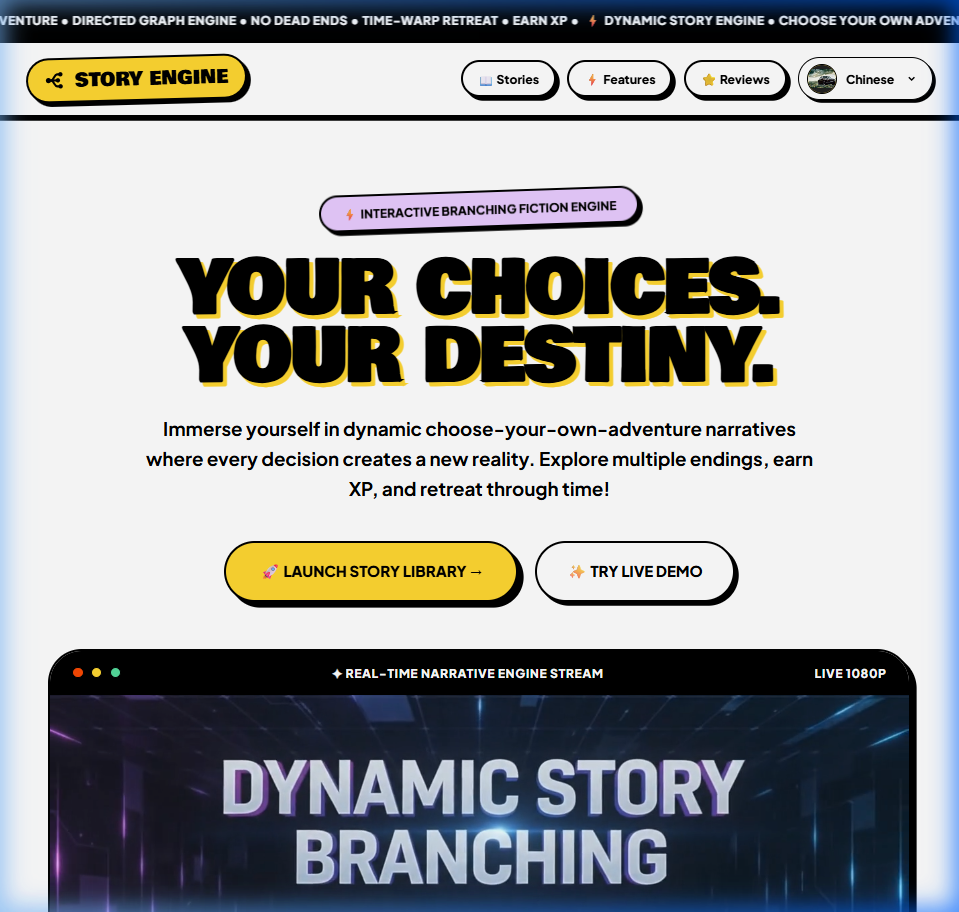
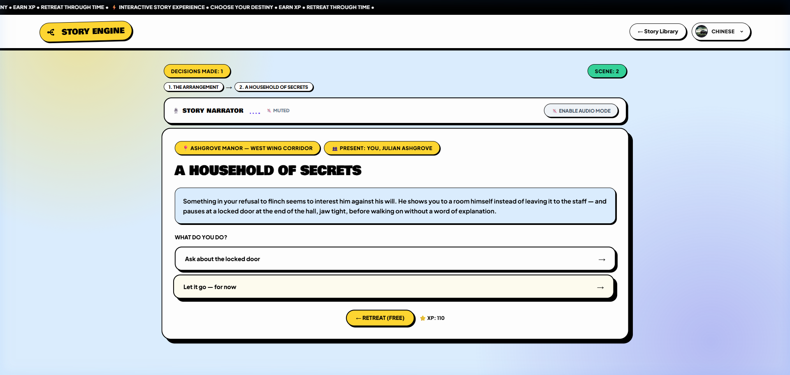
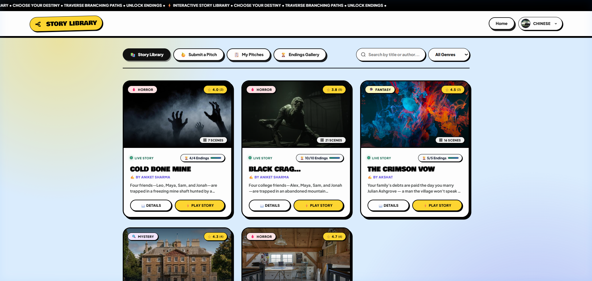
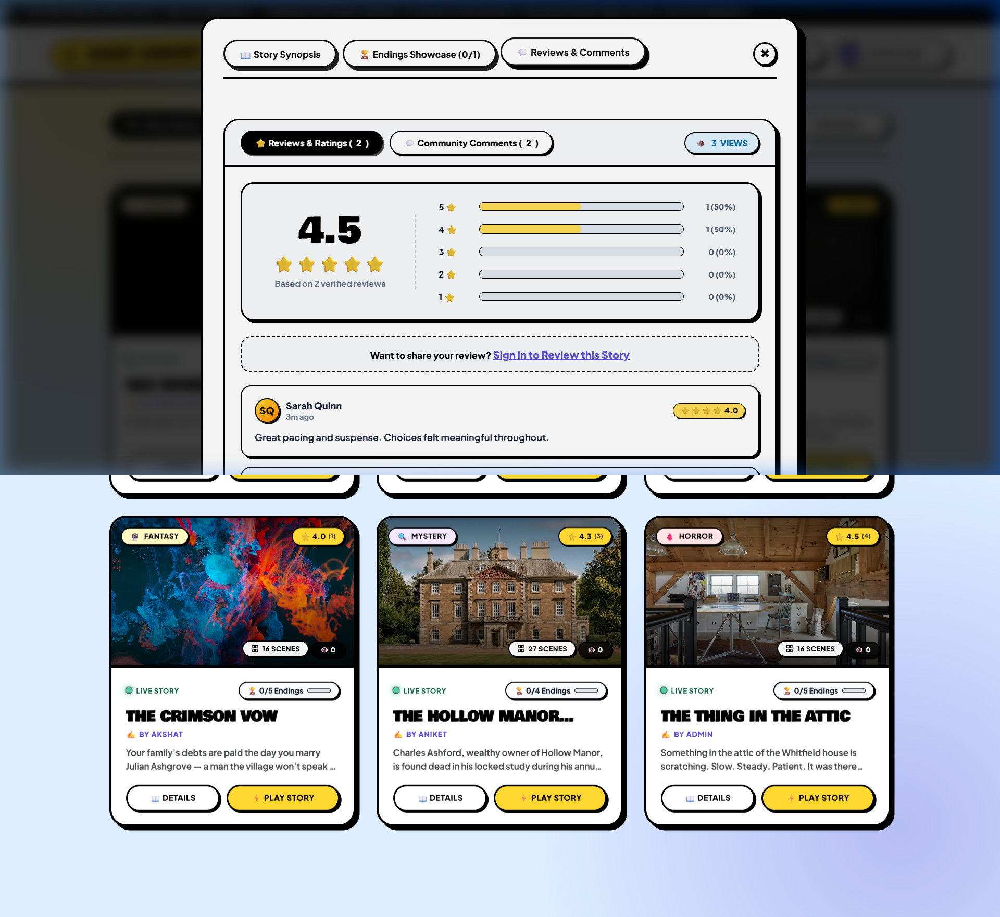
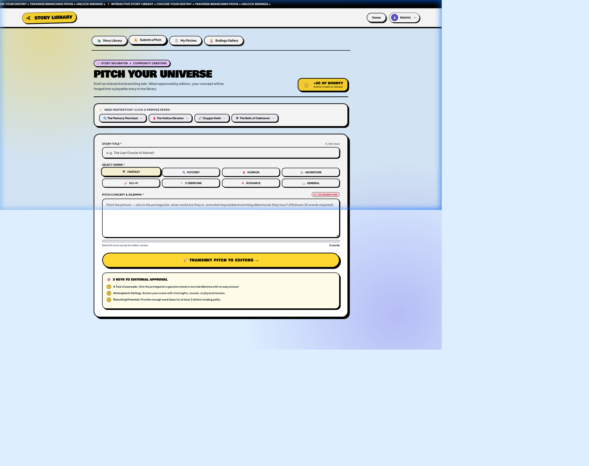
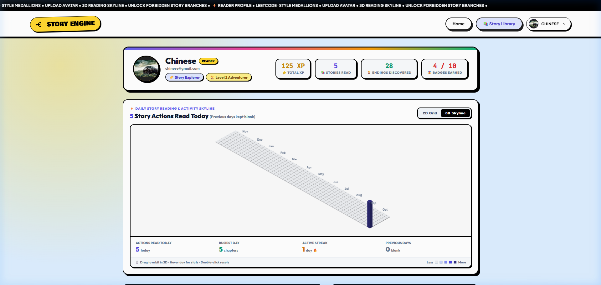
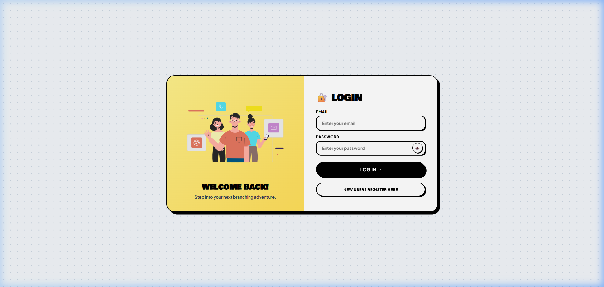

# Dynamic Story Branching Engine

A full-stack interactive fiction platform and branching narrative system powered by Node.js, Express, MongoDB Atlas, and modern client-side web technologies.

---

## Overview

The Dynamic Story Branching Engine is an interactive storytelling platform that enables creators to author branching narratives and readers to explore choice-driven story paths. Built on a Directed Acyclic Graph (DAG) architecture, the platform enforces story integrity—preventing orphaned scenes and infinite loops—while providing readers with features such as Time-Warp rewind mechanics, real-time audio narration, 3D activity tracking, and community discussions.



---

## Table of Contents

- [Overview](#overview)
- [Key Features](#key-features)
- [System Architecture](#system-architecture)
- [Application Flow](#application-flow)
- [Technology Stack](#technology-stack)
- [Project Directory Structure](#project-directory-structure)
- [Prerequisites](#prerequisites)
- [Installation and Setup](#installation-and-setup)
  - [1. Clone the Repository](#1-clone-the-repository)
  - [2. Install Dependencies](#2-install-dependencies)
  - [3. Environment Configuration](#3-environment-configuration)
  - [4. Start the Backend Server](#4-start-the-backend-server)
  - [5. Start the Frontend Client](#5-start-the-frontend-client)
  - [6. Access the Application](#6-access-the-application)
- [Default Credentials](#default-credentials)
- [API Reference](#api-reference)
- [Troubleshooting](#troubleshooting)

---

## Key Features

### 1. Interactive Story Reader
- **Directed Graph Narrative Engine**: Choices act as directed edges transitioning readers between narrative scene vertices.
- **Time-Warp Retreat**: Allows readers to step back to prior scenes and alter decisions without restarting the story.
- **Audio Narration Mode**: Built-in speech synthesis engine utilizing the Web Speech API with adjustable rate, pitch, and voice presets.
- **Decision History & Path Tracking**: Real-time HUD showing traversal trails and decision counts.



---

### 2. Story Library and Genre Filtering
- **Dynamic Catalog**: Displays published stories with cover images, scene counts, view totals, and average star ratings.
- **Search & Multi-Genre Filter**: Instant client-side search by title or author, with filters for Fantasy, Mystery, Horror, Adventure, Sci-Fi, Cyberpunk, and Romance.
- **Endings Showcase Counter**: Live indicator showing reader completion status against total story endings.



---

### 3. Community Reviews and Rating Analytics
- **Verified Reader Reviews**: 1 to 5 star ratings with detailed written feedback.
- **Rating Breakdown Histogram**: Automated distribution metrics calculating percentages across all star tiers.
- **Discussion System**: Nested comment threads supporting user responses, timestamp tracking, and community likes.



---

### 4. Community Pitch Incubator
- **User-Generated Story Ideas**: Readers submit story premises, genre classifications, and narrative dilemmas to earn +20 XP.
- **Editorial Review System**: Admins review, approve, or reject submissions and provide feedback comments.



---

### 5. Reader Profile and 3D Skyline Activity
- **Reader Progress Dashboard**: Displays Total XP, Stories Read, Endings Discovered, and earned milestone badges.
- **3D Reading Skyline**: WebGL-powered isometric activity visualization tracking daily reading sessions.



---

### 6. Admin Story Management & Scene Editor
- **Full CRUD Management**: Create, update, preview, and delete stories.
- **Node Graph Authoring**: Visually define scene vertices, choice edges, start nodes, and win/loss ending flags.
- **Sample Data Restoration**: Built-in restore function allowing instant seeding of pre-configured sample stories.

---

### 7. Authentication and Security
- **Role-Based Access Control**: Differentiates between Reader and Admin accounts.
- **JWT Authorization**: Stateless Bearer token verification on protected endpoints.
- **Password Security**: Passwords hashed with bcrypt (salt factor: 10).



---

## System Architecture

```
+-----------------------------------------------------------------------------------+
|                                  CLIENT LAYER                                     |
|                                                                                   |
|  [ Landing Page ]      [ Story Library ]      [ Story Reader ]    [ Admin Panel ] |
|   Landing.html          stories.html           play.html           admin.html     |
|   components21st.js     stories.js             reader.js           admin.js       |
|                                                                                   |
|                   Shared Authentication & API Client: auth.js                     |
+-----------------------------------------------------------------------------------+
                                         |
                                         | HTTP / JSON (REST API)
                                         v
+-----------------------------------------------------------------------------------+
|                             BACKEND API LAYER (Express)                           |
|                                                                                   |
|  [ Routing & Middleware ]                                                         |
|   - CORS Middleware (Cross-Origin Resource Sharing)                               |
|   - JSON Body Parser (10MB Payload Limit)                                         |
|   - authMiddleware.js (JWT Verification)                                          |
|                                                                                   |
|  [ Controllers ]                                                                  |
|   - authController.js     : Registration, Login, Profile                          |
|   - storyController.js    : Stories, Nodes, Choices, Scene Traversal              |
|   - sessionController.js  : Reading Sessions & Retract Paths                      |
|   - pitchController.js    : Reader Story Proposals & Review                       |
|   - reviewController.js   : Ratings, Star Breakdown Analytics                     |
|   - commentController.js  : Community Comments & Replies                          |
|   - userController.js     : XP Management, Badges, Profiles                       |
+-----------------------------------------------------------------------------------+
                                         |
                                         | Mongoose ODM (Object Data Modeling)
                                         v
+-----------------------------------------------------------------------------------+
|                               DATABASE LAYER (MongoDB)                            |
|                                                                                   |
|  [ Collections ]                                                                  |
|   - users           : Credentials, Roles, XP, Badges, Traversal History           |
|   - stories         : Metadata, Scene Vertices, Directed Edges, Endings           |
|   - storysessions   : Active Reader Sessions, Visited Nodes, Retreat Stack        |
|   - readerstories   : Reader Pitch Proposals & Status Lifecycle                   |
|   - reviews         : Star Ratings (1-5) and Written Story Critiques              |
|   - comments        : Nested Discussion Threads and Reactions                     |
+-----------------------------------------------------------------------------------+
```

---

## Application Flow

```
[ Visitor / Reader ]
        |
        v
+--------------------+      Create Account       +--------------------+
|    Landing Page    | ------------------------> |    Signup Page     |
|   (Landing.html)   |                           |    (signup.html)   |
+--------------------+                           +--------------------+
        |                                                  |
        | Log In                                           v
        +------------------------------------->  +--------------------+
                                                 |     Login Page     |
                                                 |    (login.html)    |
                                                 +--------------------+
                                                           |
                                  +------------------------+------------------------+
                                  | Role === "Reader"                               | Role === "Admin"
                                  v                                                 v
                      +-----------------------+                         +-----------------------+
                      |     Story Library     |                         |    Admin Dashboard    |
                      |     (stories.html)    |                         |     (admin.html)      |
                      +-----------------------+                         +-----------------------+
                                  |                                                 |
            +---------------------+---------------------+                           |-- Manage Stories
            |                     |                     |                           |-- Review Pitches
            v                     v                     v                           |-- Moderate Comments
  +-------------------+ +-------------------+ +-------------------+                 v
  |    Play Story     | |    Submit Pitch   | |   View Profile    |     +-----------------------+
  |    (play.html)    | | (Pitch Incubator) | |   (profile.html)  |     |   Story Scene Editor  |
  +-------------------+ +-------------------+ +-------------------+     |   (add_stories.html)  |
            |                     |                     |               +-----------------------+
            |-- Traverse Choices  |-- +20 XP Bounty     |-- 3D Skyline              |
            |-- Audio Narrator    |-- Admin Feedback    |-- XP Medallions           |-- Define Nodes
            |-- Time-Warp Rewind  |                     |-- Reading Stats           |-- Connect Choices
            |-- Unlock Endings    |                                                 |-- Validate Graph
            |-- Write Review      |                                                 |-- Publish to Readers
            v                     v                                                 v
  +-----------------------------------------------------------------------------------+
  |                       MongoDB Atlas Persistent Cloud Storage                      |
  +-----------------------------------------------------------------------------------+
```

---

## Technology Stack

| Layer | Component | Description |
|---|---|---|
| **Runtime Environment** | Node.js | Asynchronous JavaScript server runtime (v18+) |
| **Backend Framework** | Express.js 4.x | Fast, unopinionated REST API framework |
| **Database** | MongoDB Atlas | Cloud-hosted NoSQL document database |
| **ODM Library** | Mongoose 8.x | Schema-based data modeling and validation |
| **Authentication** | JWT & bcryptjs | Stateless token authentication and salted password hashing |
| **Frontend Architecture** | Vanilla HTML5 / CSS3 / ES6+ | Zero-framework, lightweight frontend architecture |
| **Visual 3D Engine** | Three.js (WebGL) | Powers the interactive 3D reading activity skyline |
| **Speech Engine** | Web Speech API | Browser-native Text-To-Speech audio narration |
| **Design System** | Custom Neo-Brutalist CSS | High-contrast layouts, geometric borders, and fluid typography |

---

## Project Directory Structure

```
Dynamic_Story_Branching/
│
├── backend/                              # Express REST API & Database Integration
│   ├── config/
│   │   └── db.js                         # MongoDB connection utility
│   ├── controllers/
│   │   ├── authController.js             # User registration, login, and profile
│   │   ├── commentController.js          # Nested comment threads and reactions
│   │   ├── pitchController.js            # Reader community pitches
│   │   ├── reviewController.js           # Story reviews, star ratings, and analytics
│   │   ├── sessionController.js          # Reading sessions and traversal state
│   │   ├── storyController.js            # Stories, scene graph, and DAG validation
│   │   └── userController.js             # User data, XP adjustments, and badges
│   ├── middleware/
│   │   └── authMiddleware.js             # JWT bearer verification and admin checks
│   ├── models/
│   │   ├── Comment.js                    # Comments Mongoose schema
│   │   ├── ReaderStory.js                # Pitches Mongoose schema
│   │   ├── Review.js                     # Story reviews Mongoose schema
│   │   ├── Story.js                      # Stories, scene nodes, and choices schema
│   │   ├── StorySession.js               # User traversal session schema
│   │   └── User.js                       # User credentials and progression schema
│   ├── Routes/
│   │   ├── authRoutes.js                 # /register, /login, /profile
│   │   ├── commentRoutes.js              # /Comments endpoints
│   │   ├── pitchRoutes.js                # /ReaderStories endpoints
│   │   ├── reviewRoutes.js               # /Reviews endpoints
│   │   ├── sessionRoutes.js              # /StorySessions endpoints
│   │   ├── storyRoutes.js                # /Stories endpoints
│   │   └── userRoutes.js                 # /Users endpoints
│   ├── scripts/
│   │   └── migrate_db.js                 # Data migration utility
│   ├── .env.example                      # Environment variable template
│   ├── package.json                      # Backend dependencies
│   ├── readme.md                         # Backend specific guide
│   └── server.js                         # Application entrypoint
│
├── frontend/                             # Client-side Web Application
│   ├── css/                              # Modular stylesheet system
│   │   ├── admin.css                     # Admin panel and creator styles
│   │   ├── components21st.css            # Specialized UI components & carousels
│   │   ├── login.css                     # Authentication forms styling
│   │   ├── profile.css                   # Profile metrics & skyline layout
│   │   ├── reader.css                    # Story player & choice buttons
│   │   ├── reviewsComments.css           # Review cards, breakdown bars, comments
│   │   ├── signup.css                    # Registration form styling
│   │   └── stories.css                   # Story library and metadata editor
│   ├── js/                               # Client-side JavaScript modules
│   │   ├── admin.js                      # Admin dashboard & pitch moderation
│   │   ├── auth.js                       # Token storage & route guards
│   │   ├── badgeCelebration.js           # Milestone badge notifications
│   │   ├── config.js                     # Environment-aware API URL selector
│   │   ├── login.js                      # Login logic
│   │   ├── profile.js                    # Profile dashboard integration
│   │   ├── reader.js                     # Traversal engine, retreat, and TTS
│   │   ├── reviewsComments.js            # Reviews & YouTube-style comments
│   │   ├── signup.js                     # User registration logic
│   │   ├── skyline.js                    # Three.js 3D skyline activity graph
│   │   └── stories.js                    # Story catalog and scene editor
│   ├── pages/
│   │   ├── admin/
│   │   │   ├── add_stories.html          # Visual story graph authoring editor
│   │   │   ├── admin.html                # Admin management dashboard
│   │   │   └── preview.html              # Story preview page
│   │   ├── auth/
│   │   │   ├── login.html                # Login interface
│   │   │   └── signup.html               # Registration interface
│   │   └── reader/
│   │       ├── play.html                 # Interactive story player
│   │       ├── profile.html              # User profile and 3D skyline
│   │       └── stories.html              # Story library and pitch studio
│   ├── Landing.html                      # Public home and showcase page
│   └── index.html                        # Root redirect to Landing page
│
├── docs/                                 # Documentation assets
│   └── screenshots/                      # High-resolution application screenshots
│
├── package.json                          # Root repository package configuration
└── README.md                             # Main repository documentation
```

---

## Prerequisites

Before starting, ensure you have the following installed on your machine:
- **Node.js**: Version 18.0.0 or higher ([Download Node.js](https://nodejs.org/))
- **npm**: Version 9.0.0 or higher (packaged with Node.js)
- **MongoDB**: Either a free cloud [MongoDB Atlas](https://www.mongodb.com/atlas/database) account or a locally installed MongoDB community server.

---

## Installation and Setup

### 1. Clone the Repository

```bash
git clone https://github.com/Ani29hs/Dynamic_Story.git
cd Dynamic_Story
```

---

### 2. Install Dependencies

Install the project root and backend dependencies:

```bash
# Install root utility dependencies
npm install

# Install backend server dependencies
cd backend
npm install
cd ..
```

---

### 3. Environment Configuration

Because the repository does not track sensitive credentials, you must configure a local `.env` file for the backend server.

A template is provided at `backend/.env.example`. Create your `.env` file inside the `backend` directory:

#### On Windows (PowerShell):
```powershell
Copy-Item backend\.env.example backend\.env
```

#### On Linux / macOS:
```bash
cp backend/.env.example backend/.env
```

Open `backend/.env` in your text editor and specify your connection values:

```env
# Port on which the Express server will listen
PORT=5000

# MongoDB Connection String (Atlas Cluster URI or local MongoDB instance)
MONGO_URI=mongodb+srv://<username>:<password>@cluster0.mongodb.net/dynamic_stories?retryWrites=true&w=majority

# Secret key used for signing JWT authentication tokens
SECRET_KEY=PASSKEY
```

> **Setting Up MongoDB Atlas (Quick Guide)**:
> 1. Create a free account at [mongodb.com/atlas](https://www.mongodb.com/atlas).
> 2. Create a free Shared Cluster (M0).
> 3. Under **Database Access**, create a user with read/write privileges (save the username and password).
> 4. Under **Network Access**, add IP address `0.0.0.0/0` (allow access from anywhere).
> 5. Click **Connect** -> **Drivers** -> Copy the connection string and paste it into `MONGO_URI` in `backend/.env`.
> 
> *Alternatively, for local MongoDB, set `MONGO_URI=mongodb://localhost:27017/dynamic_stories`.*

---

### 4. Start the Backend Server

Start the Express API server:

```bash
npm run dev:backend
```

*Or directly from the backend directory:*
```bash
cd backend
node server.js
```

Upon successful startup, the console will output:
```
Connected to MongoDB Atlas successfully
Server running on http://localhost:5000 (maxHeaderSize: 1MB)
```

---

### 5. Start the Frontend Client

Open a second terminal window in the root directory and start the client server:

```bash
npm run dev:frontend
```

*Or directly using npx serve:*
```bash
npx serve -p 8000 frontend
```

The frontend application will be hosted at `http://localhost:8000`.

---

### 6. Access the Application

1. Open your browser and navigate to:
   ```
   http://localhost:8000
   ```
2. The browser automatically opens `Landing.html`.
3. To seed initial stories and scenes, log in with the Administrator account and click **"Restore Sample Story"** in the Admin Dashboard.

---

## Default Credentials

| Role | Email Address | Password | Permissions |
|---|---|---|---|
| **Administrator** | `admin@gmail.com` | `admin123` | Author stories, edit scene graph, approve/reject pitches, moderate reviews |
| **Reader** | *Self-registered via signup* | *User password* | Play stories, use retreat tokens, submit pitches, write reviews, post comments |

---

## API Reference

The backend exposes a REST API running by default on `http://localhost:5000`.

### Authentication
| Method | Endpoint | Description | Auth Required |
|---|---|---|---|
| `POST` | `/register` | Register a new user account | None |
| `POST` | `/login` | Authenticate credentials and retrieve JWT | None |
| `GET` | `/profile` | Fetch authenticated user profile data | `Bearer <token>` |

### Stories & Narrative Graph
| Method | Endpoint | Description | Auth Required |
|---|---|---|---|
| `GET` | `/Stories` | List stories (filterable by `?status=published` or `?genre=...`) | User / Admin |
| `GET` | `/Stories/:id` | Retrieve full story object with scene nodes and choices | User / Admin |
| `POST` | `/Stories` | Create a new story draft | Admin |
| `PATCH` | `/Stories/:id` | Update story metadata or scene graph nodes | Admin |
| `PUT` | `/Stories/:id` | Replace entire story document | Admin |
| `DELETE` | `/Stories/:id` | Permanently delete a story | Admin |
| `POST` | `/Stories/:id/view` | Increment live view counter for a story | Admin |
| `POST` | `/Stories/restore-sample` | Reset and restore default sample stories dataset | Admin |

### Reader Sessions
| Method | Endpoint | Description | Auth Required |
|---|---|---|---|
| `GET` | `/StorySessions` | Retrieve active reading session by `userId` and `storyId` | None |
| `POST` | `/StorySessions` | Initialize or persist a reading session | None |
| `PATCH` | `/StorySessions/:id` | Update current scene position and choice history | None |

### Community Pitches
| Method | Endpoint | Description | Auth Required |
|---|---|---|---|
| `GET` | `/ReaderStories` | List community story pitches | Admin |
| `POST` | `/ReaderStories` | Submit a reader story proposal (+20 XP bounty) | User |
| `PATCH` | `/ReaderStories/:id` | Update pitch status (`approved` / `rejected`) with feedback | Admin |
| `DELETE` | `/ReaderStories/:id` | Delete a submitted pitch | User / Admin |

### Reviews & Comments
| Method | Endpoint | Description | Auth Required |
|---|---|---|---|
| `GET` | `/Reviews` | List story reviews (filterable by `?storyId=...`) | None |
| `POST` | `/Reviews` | Create or update a star review with rating | User |
| `DELETE` | `/Reviews/:id` | Delete a user review | User / Admin |
| `GET` | `/Comments` | Retrieve comments and nested reply threads for a story | None |
| `POST` | `/Comments` | Post a new top-level comment or reply | User |
| `POST` | `/Comments/:id/like` | Toggle like reaction on a comment | User |
| `DELETE` | `/Comments/:id` | Delete a comment | User / Admin |

---

## Troubleshooting

### 1. MongoDB Connection Errors
- **Symptom**: `MongoServerError: bad auth : Authentication failed` or `MongoDB connection failed`.
- **Solution**: Check that the username and password in `backend/.env` match your MongoDB Atlas database user. If your password contains special characters (e.g. `@`, `:`, `#`), ensure they are URL-encoded (for example, `@` becomes `%40`).
- **Symptom**: `MongooseServerSelectionError: connection timed out`.
- **Solution**: In MongoDB Atlas, go to **Network Access** and verify that IP Address `0.0.0.0/0` (Allow Access from Anywhere) is active.

### 2. Port Conflicts
- **Symptom**: `Error: listen EADDRINUSE: address already in use :::5000`.
- **Solution**: Terminate the process currently occupying port 5000, or edit `PORT=5001` in `backend/.env`.

### 3. Audio Narration Not Playing
- **Symptom**: Clicking "Enable Audio Mode" does not produce speech.
- **Solution**: Ensure your browser allows autoplay audio. In Chromium browsers, click anywhere on the page first, as modern browsers require user interaction before playing Web Speech API audio.

---

## License

This project is open-source and available under the standard MIT License.